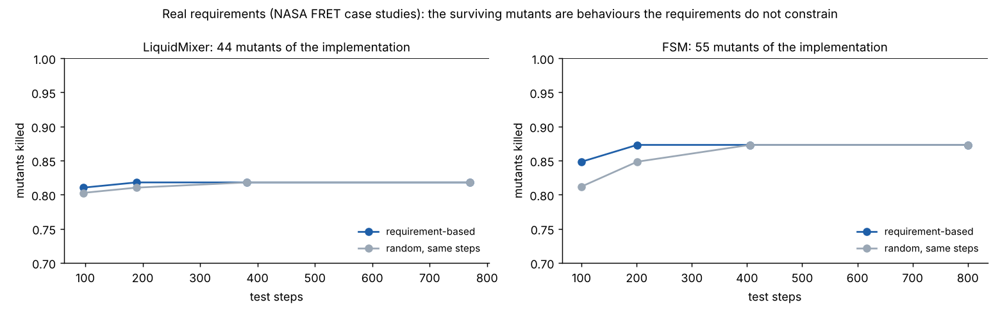
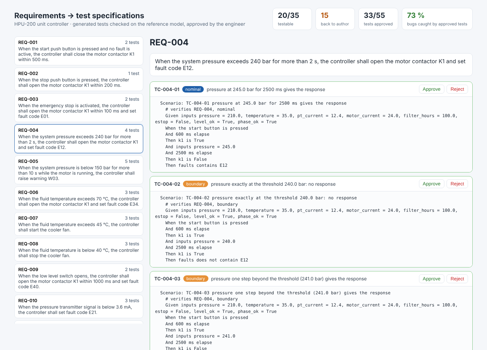
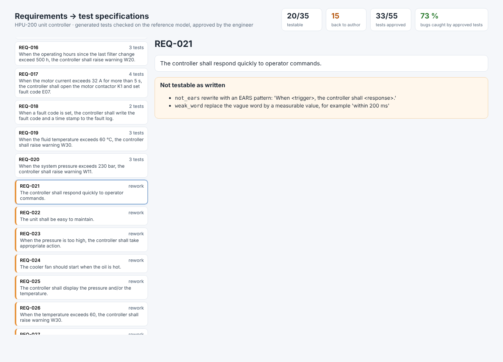
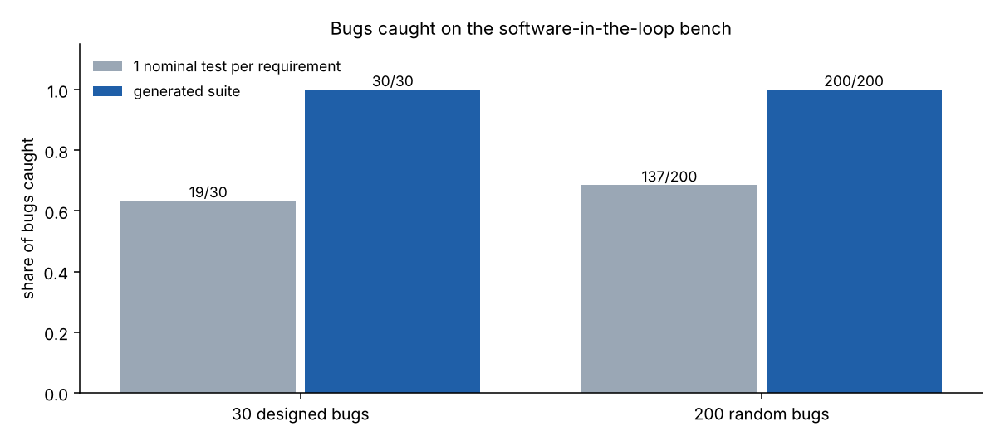
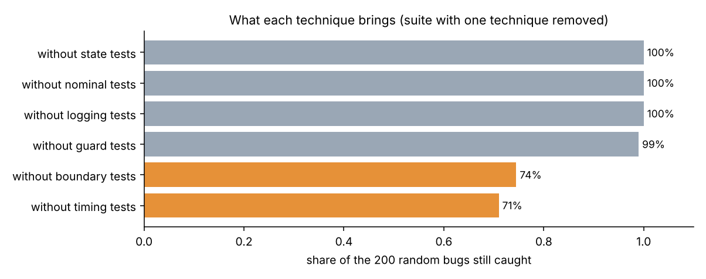

# From requirements to test specifications, checked on a software-in-the-loop bench

[](https://github.com/kawtar-bellamine/req2test-vv/actions/workflows/tests.yml)

Writing test specifications from requirements is a large part of verification and validation (V&V) work, and a
test is only worth something if it would catch a real bug. This project builds an assistant that reads the software
requirements of a controller, **sends back the ones that are not testable with the reason and a suggested rewrite**,
**generates test specifications with classic V&V techniques** (boundary values, timing, guards, states),
**checks every test on a reference model before showing it**, lets the engineer approve or reject each test, and
exports the traceability matrix and Gherkin scenarios. The suite is then measured the way it matters: **how many
injected bugs does it catch?**

**Part 1, real requirements.** The method is first applied to requirements written by others: the case studies
shipped with **[NASA's FRET](https://github.com/NASA-SW-VnV/fret)** (Formal Requirements Elicitation Tool), fetched
at a pinned commit and written in FRETish, FRET's structured English. The liquid mixer (12 requirements, an
industrial batch controller) and the autopilot and sensor mode logic from the Lockheed Martin cyber-physical
challenge problems (13 requirements) are parsed completely; of the two larger sets, 44 of 57 (Lift+Cruise) and 52 of
97 (LMCPS) parse, the others use functions or scopes not yet supported (`preBool`, `persisted`, `in mode`).

**Part 2, the full workflow** (quality gate, test specifications, review interface, exports) is shown on a fictional
hydraulic power unit controller, HPU-200: 35 requirements written for this project, 15 of them deliberately
defective, and a Python model of the controller.

## Part 1: real requirements from NASA FRET

[`req2test/fret.py`](req2test/fret.py) parses FRETish (*when / whenever / upon / if* condition, *immediately, at the
next timepoint, within N ticks, for N ticks, always, until*) into expression trees with a small parser of its own
(nothing is passed to `eval`), and gives each requirement its meaning on a finite trace.
[`req2test/fret_vv.py`](req2test/fret_vv.py) then:

1. **reviews** the set: for every combination of inputs (under the environment assumption that level 2 implies
   level 1), are the obligations of all triggered requirements satisfiable together? and does a requirement without
   a condition only constrain the start of the run?
2. **generates tests from the requirements** (each one triggered with its condition going from false to true, the
   other inputs varied, the release condition of *until* held off) and runs them on an implementation written from
   the informal description of each case study ([`req2test/sut/`](req2test/sut/));
3. **measures the tests by mutation**: every single-point change of the implementation's code (and/or swapped,
   comparison inverted, condition negated, constant flipped, assignment deleted), generated from its syntax tree.

| | Liquid mixer | Autopilot mode logic (FSM) |
|---|---|---|
| Requirements parsed | 12 / 12 | 13 / 13 |
| **Pairs of requirements that contradict each other** | **1** | **4** |
| Requirements that only constrain the first steps | 0 | 2 (FSM-006, FSM-007) |
| Requirements the implementation fails | 2 | 4, each one half of a contradicting pair |
| Mutants killed by the requirement-based tests | 36 / 44 (82%) | 48 / 55 (87%) |
| Same, random tests of the same length | 82% | 87% |

### Findings

1. **The review finds contradictions in published requirements.** Liquid mixer: if the start button and the
   emergency button are pressed together with the tank below level 1, LM-001 requires valve 0 open and LM-009
   requires it closed. Autopilot: in TRANSITION with the pilot in control and good, supported sensors, FSM-002
   requires STANDBY and FSM-003 requires NOMINAL; three more pairs of the same kind (no priority between two
   transition rules). Whatever priority the implementation chooses, one requirement of each pair fails: the four
   failures of the FSM implementation are exactly these.

2. **Two requirements do not say what their rationale says.** FSM-006 (*shall for 5 ticks satisfy ...*) and FSM-007
   (*shall within 5 ticks satisfy ...*) have no condition, so they only constrain the first 5 steps of a run, while
   their rationale describes transition rules that hold at all times.

3. **Passing every requirement does not make the controller right.** On a realistic cycle written by hand (start,
   fill to level 1, to level 2, stir, drain), the first implementation passes all 12 requirements and yet restarts
   the stirring motor and the 60 s timer while level 2 is still detected, and opens the filling valve 1 again while
   the tank drains through valve 2. Nothing forbids the first; LM-003 even demands the second: once level 2 is no
   longer detected, valve 1 must be open until an emergency, which during draining means filling and draining at
   once.

4. **The surviving mutants list the missing requirements.** Of the 8 mutants of the liquid mixer that no test
   kills, one is equivalent (a copy of the state removed); the 7 others start the timers at every cycle, open valve 0
   without the start button, keep the stirring motor running after the 60 s, or never close valve 2. No requirement
   constrains these behaviours: each one says what must happen *when* something occurs, none says what must *not*
   happen otherwise (*the 60 s timer shall start only when level 2 is reached*, *the motor shall stop when the 60 s
   timer expires*).

5. **On these small controllers, random tests are as strong as requirement-based ones** (82% and 87% of the mutants
   for both, from 100 to 800 steps); requirement-based tests are slightly ahead only at the smallest budget on the
   FSM. Their value is traceability: each test is tied to the requirement it triggers, and all 12 conditions of the
   liquid mixer are triggered by construction.



All numbers: [`results/fret_metrics.json`](results/fret_metrics.json).

## Part 2: the full workflow on a fictional controller (HPU-200)

> The requirements (35) describe the controller of a hydraulic power unit, HPU-200, written for this project with
> 15 deliberately defective ones. The "implementation under test" is a Python model of the controller
> ([`req2test/bench.py`](req2test/bench.py)), written from the intended behaviour and independently of the
> requirement parser.



### How it works

The workflow is a [LangGraph](https://github.com/langchain-ai/langgraph) graph ([`req2test/graph.py`](req2test/graph.py)):

```
requirements ─► parse (EARS + interface dictionary) ─► quality gate ─┬─► not testable: back to the author
                                                                     │   (reason, suggested rewrite, optional LLM rewrite)
                                                                     └─► generate tests ─► run on the reference model
                                                                         ─► engineer review (approve / reject)
                                                                         ─► traceability matrix, Gherkin .feature, JSON
```

- **Parsing** ([`req2test/parse.py`](req2test/parse.py)): EARS patterns (*When*, *If ... then*, *While*) and an
  interface dictionary ([`data/signals.yaml`](data/signals.yaml)) that maps the words of the requirements to the
  signals of the bench, with their units and resolution. A requirement is testable only if its trigger and every
  response map to the dictionary with explicit values. Nothing is guessed.
- **Quality gate**: weak words (*quickly*, *as soon as possible*), *should*, *and/or*, *etc.*, escape clauses
  (*if necessary*, *unless*), passive voice without an actor, vague conditions (*too high*), numbers without unit.
- **Generation** ([`req2test/generate.py`](req2test/generate.py)): nominal case, boundary value analysis (exactly at
  the threshold, one resolution step beyond), timing (just before and after a persistence delay, response deadline),
  guards (the condition that must block the response), invariants watched over a time window (K1 *never* closes while
  a fault is active), logging.
- **Bench**: a 10 ms step model of the controller and a runner that plays each test. Mutants are bugs injected in
  that model: 30 written by hand and 200 generated at random (a threshold moved by 1 to 5 resolution steps, a delay
  changed by 15% to 50%, a response slower than its deadline, a flag inverted, a fault code swapped).
- **Review and export**: FastAPI + React. The engineer approves or rejects each test; the header shows how many
  injected bugs the approved tests catch. With an OpenAI-compatible endpoint (Azure OpenAI or other), a model
  proposes a testable rewrite of each rejected requirement; the proposal is shown, never applied.

### Findings

1. **All 15 defective requirements are sent back, with no false alarm** on the 20 good ones. The gate names 16 of the
   25 defects the reviewer labelled; the others (*unverifiable*, *no timing*, *undefined term*) are still caught,
   because such requirements cannot be mapped to the interface dictionary.

   

2. **55 test specifications for the 20 testable requirements, every requirement covered**: 24 boundary, 14 nominal,
   8 timing, 4 logging, 3 guard, 2 state. All 55 pass on the reference model.

3. **The generated suite catches every injected bug; one nominal test per requirement catches two thirds.** On the 30
   designed bugs: 30 against 19. On 200 random bugs never looked at while writing the generator: **200 against 137**.

   

4. **Timing and boundary tests do most of the work.** Without the timing tests, the suite catches 71% of the random
   bugs; without the boundary tests, 74%. The bugs a nominal test misses are thresholds moved by a few units and
   delays changed by a few hundred milliseconds: a value well beyond the threshold still triggers the response.

   

5. **Some bugs only show between two checks.** A start command accepted with an active fault closed K1 for 20 ms
   before the fault opened it again, and a reset cleared a fault for one cycle before it came back. Both passed the
   first version of the tests, which checked the state once at the end. Watching the output over the whole window
   (an invariant) catches them.

| | Result |
|---|---|
| Defective requirements sent back / false alarms | 15/15 / 0 |
| Testable requirements covered by at least one test | 20/20 |
| Tests generated / failing on the reference model | 55 / 0 |
| Designed bugs caught, naive vs generated | 19/30 vs 30/30 |
| Random bugs caught, naive vs generated | 137/200 vs 200/200 |

Outputs: [`results/export/traceability_matrix.csv`](results/export/traceability_matrix.csv),
[`results/export/hpu200_controller.feature`](results/export/hpu200_controller.feature), all numbers in
[`results/metrics.json`](results/metrics.json).

## Run it

```bash
pip install -r requirements.txt
python -m req2test.fret_vv                    # part 1: FRET case studies (fetched at a pinned commit)
python -m req2test.plots_fret
./run_all.sh                                  # part 2: evaluation, exports, figures
cd web && npm install && npx vite build && cd ..
uvicorn app.api:app --port 8000               # review interface on http://localhost:8000
pytest -q
```

Or `docker build -t req2test . && docker run -p 8000:8000 req2test`.

## Limits

- Part 1: the review checks contradictions within one step; contradictions that only appear over several steps (an
  *until* against a later trigger) need a model checker, which is what FRET's realizability checking does.
- Part 2: the requirements and the reference model are written by the same person; the 100% score says that the suite
  covers the bug types it was designed for (single-parameter faults on thresholds, delays, codes, guards), not that
  it would catch any bug. Combined faults and faults in the sequencing logic would need state-machine coverage.
- The parser handles the EARS patterns of this set; free-form requirements go back to the author by design.
- A real V&V bench (HIL, PLC simulator or SystemVerilog/UVM environment for hardware) would replace the Python model;
  the runner only needs a step function and the signal names of the interface dictionary.

Kawtar Bellamine, 2026.
